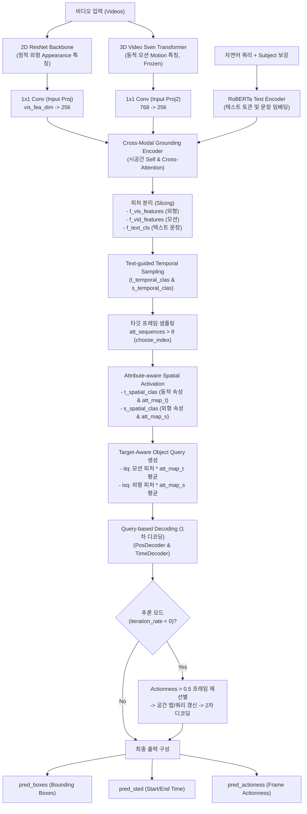

# TA-STVG (Target-Aware Spatio-Temporal Video Grounding) 소스 코드 분석 보고서

본 문서는 **TA-STVG**의 핵심 모델 구현체인 [`models/pipeline.py`](models/pipeline.py)의 `TASTVGNet` 클래스와 모델 및 학습 설정을 담당하는 [`config/defaults.py`](config/defaults.py)의 상세 분석 내용을 정리한 기술 문서입니다.

---

## 1. 개요 및 핵심 동기 (Motivation)

* **논문**: *“Knowing Your Target: Target-Aware Transformer Makes Better Spatio-Temporal Video Grounding”* (ICLR 2025 Oral)
* **STVG (Spatio-Temporal Video Grounding) 태스크**:
  * 비디오(Video)와 자연어 쿼리(Text Query)가 입력되었을 때, 텍스트가 서술하는 특정 타깃 객체의 **시간 구간(시작/종료 시점, Start & End timestamps)**과 해당 구간 동안의 **공간 바운딩 박스 궤적(Bounding Box trajectory)**을 동시에 예측하는 과제입니다.
* **기존 기법의 한계**:
  * 기존 DETR 계열 Transformer 기반 STVG 모델들은 디코더의 객체 쿼리(Object Query)를 **영벡터(zeros)** 또는 무작위 학습 파라미터로 초기화합니다.
  * 이로 인해 디코더가 타깃에 대한 사전 지식(Cues) 없이 멀티모달 피처를 탐색하므로 불필요한 배경 정보에 노출되고 판별력이 떨어집니다.
* **TA-STVG의 핵심 기여**:
  * 멀티모달 인코더 출력으로부터 비디오와 텍스트의 상호작용을 통해 타깃 객체의 **시공간 단서(Target-Aware Cues)**를 사전에 추출합니다.
  * **Text-guided Temporal Sampling**과 **Attribute-aware Spatial Activation**을 통해 타깃 맞춤형 공간(Spatial) 및 시간(Temporal) 쿼리를 동적으로 생성하여 디코더에 주입합니다.
  * 추론 시 1차 예측된 Actionness 점수를 바탕으로 프레임을 재필터링하고 쿼리를 갱신하는 **반복적 정제(Iterative Refinement)**를 수행합니다.

---

## 2. 전체 아키텍처 및 데이터 흐름

---

## 3. `models/pipeline.py` (`TASTVGNet`) 분석

### 3.1 주요 모듈 구성 (`__init__`)

| 모듈 변수명 | 구성 요소 / 클래스 | 역할 및 상세 설명 |
| :--- | :--- | :--- |
| `vis_encoder` | `build_vis_encoder(cfg)` (ResNet-50/101) | 각 비디오 프레임의 2D 정적 시각 외형(Appearance) 특징 및 2D 사인 위치 인코딩 추출 |
| `input_proj` | `nn.Conv2d(vis_fea_dim, hidden_dim, 1)` | 2D 백본 출력 채널(예: 2048)을 트랜스포머 은닉 차원(256)으로 차원 축소 |
| `vid` | `vidswin_model("video_swin_t_p4w7")` | Kinetics-400 사전학습된 3D Video Swin 백본. 시공간 동작(Motion) 특징 추출 (가중치 고정) |
| `input_proj2` | `nn.Conv2d(768, hidden_dim, 1)` | 3D Swin 출력 채널(768)을 트랜스포머 은닉 차원(256)으로 차원 축소 |
| `text_encoder` | `build_text_encoder(cfg)` (RoBERTa) | 자연어 쿼리 텍스트를 토큰 임베딩(`text_outputs`) 및 문장 표현(`text_cls`)으로 변환 |
| `ground_encoder` | `CrossModalEncoder(cfg)` | 외형(2D), 모션(3D), 언어(Text) 세 모달리티 시퀀스를 결합하여 공간/시간 교차 어텐션 수행 |
| `s_temporal_clas` | `TemporalSampling(hidden_dim)` | 텍스트 임베딩을 쿼리로 외형 피처와 상호작용하여 프레임별 타깃 관련도 점수(`logits_f_a`) 산출 |
| `t_temporal_clas` | `TemporalSampling(hidden_dim)` | 텍스트 임베딩을 쿼리로 모션 피처와 상호작용하여 프레임별 타깃 관련도 점수(`logits_f_m`) 산출 |
| `s_spatial_clas` | `SpatialActivation(hidden_dim, APP_NUM)` | 선택된 프레임에서 외형 속성(형용사) 분류 점수(`logits_r_a`) 및 공간 어텐션 맵(`att_map_s`) 생성 |
| `t_spatial_clas` | `SpatialActivation(hidden_dim, MOT_NUM)` | 선택된 프레임에서 동작 속성(동사) 분류 점수(`logits_r_m`) 및 시간 어텐션 맵(`att_map_t`) 생성 |
| `ground_decoder` | `QueryDecoder(cfg)` | 생성된 타깃 인식 쿼리(`isq`, `itq`)를 바탕으로 `PosDecoder`와 `TimeDecoder` 실행 |
| `bbox_embed` | `MLP(hidden_dim, hidden_dim, 4, 3)` | 각 프레임의 바운딩 박스 좌표 $(c_x, c_y, w, h)$ 회귀 MLP |
| `temp_embed` | `MLP(hidden_dim, hidden_dim, 2, 2)` | 타깃 구간의 시작/종료 시점(Start / End time) 예측 MLP |
| `action_embed` | `MLP(hidden_dim, hidden_dim, 1, 2)` | 프레임별 타깃 행동 존재 확률(Actionness) 예측 MLP |
| `theta` | `float` (VidSTG: 0.45, HC-STVG: 0.7) | 시간 샘플링 시 타깃 프레임을 선별하는 임계값 |

---

### 3.2 순전파 단계별 실행 파이프라인 (`forward`)

1. **Step 1: 시각 특징 추출 (Visual Feature Extraction)**
   * 2D ResNet 백본을 통해 각 프레임의 외형 특징을 추출하고 1x1 Conv로 256차원으로 투영: `vis_features`
   * 3D Video Swin을 통해 비디오 모션 특징을 추출하고 1x1 Conv로 256차원으로 투영: `vid_features`
2. **Step 2: 텍스트 특징 추출 및 주어 보강 (Text Feature Extraction & Subject Augmentation)**
   * 주석 파일(annotations)에서 타깃의 Subject(주어 명사구)를 추출하여 기존 쿼리 앞에 추가: `texts = [subject + " " + texts[0]]`
   * RoBERTa를 통과시켜 토큰 임베딩 `text_outputs`와 문장 임베딩 `text_cls` 획득
3. **Step 3: 멀티모달 상호작용 및 특징 분리 (Cross-Modal Fusion & Slicing)**
   * `ground_encoder`에서 `[vis_features; text_features; vid_features]` 시퀀스를 결합하여 교차 어텐션 수행
   * 공간 토큰 수($l = H \times W$) 단위로 분리:
     * `f_vis_features`: 시퀀스 앞부분 `[:l]` (외형 피처)
     * `f_vid_features`: 시퀀스 끝부분 `[-l:]` (모션 피처)
     * `f_text_cls`: 중간 텍스트 토큰 `[l:-l]`의 평균 벡터 (문장 표현)
4. **Step 4: 텍스트 유도 시간 샘플링 (Text-guided Temporal Sampling)**
   * 텍스트 쿼리(`f_text_cls`)를 활용해 모션 점수(`logits_f_m`)와 외형 점수(`logits_f_a`) 계산:
     $$\text{att\_sequences} = \frac{\sigma(\text{logits\_f\_m}) + \sigma(\text{logits\_f\_a})}{2}$$
   * $\text{att\_sequences} > \theta$ 인 프레임 인덱스 `choose_index` 선별
5. **Step 5: 속성 인식 공간 활성화 (Attribute-aware Spatial Activation)**
   * 선별된 프레임 `choose_index`에 대해서만 연산하여 배경 노이즈 억제 및 연산량 최소화
   * 동작 속성 점수 `logits_r_m` 및 시공간 어텐션 맵 `att_map_t` 획득
   * 외형 속성 점수 `logits_r_a` 및 공간 어텐션 맵 `att_map_s` 획득
6. **Step 6: 타깃 인식 객체 쿼리 생성 (Target-Aware Object Query Generation)**
   * 초기 시간 쿼리 ($\text{itq}$): 선택된 프레임들의 모션 피처와 `att_map_t`의 가중합 평균
   * 초기 공간 쿼리 ($\text{isq}$): 선택된 프레임들의 외형 피처와 `att_map_s`의 가중합 평균
7. **Step 7: 쿼리 기반 디코딩 (Query-based Decoding)**
   * 생성된 $\text{isq}, \text{itq}$를 `ground_decoder`에 입력하여 1차 바운딩 박스 특징(`outputs_pos`) 및 시간 구간 특징(`outputs_time`) 디코딩
8. **Step 8: 추론 시 반복 쿼리 정제 (Iterative Query Refinement)**
   * `iteration_rate < 0` (추론 모드): 1차 디코딩의 Actionness 예측 확률($> 0.5$)을 기준으로 타깃 프레임을 재선별
   * 재선별된 프레임으로 공간 맵과 $\text{isq}, \text{itq}$를 갱신한 후 2차 디코딩을 수행하여 시공간 검출 성능 극대화
9. **Step 9: 출력 패키징 (Output Packaging)**
   * `pred_boxes`: 프레임별 바운딩 박스 좌표 $(c_x, c_y, w, h)$
   * `pred_sted`: 시작/종료 시점 예측 구간
   * `pred_actioness`: 프레임별 Actionness 예측 확률
   * 보조 손실(`aux_outputs`) 및 프레임 샘플링 평가 지표(`pr`: Precision, Recall) 구성

---

## 4. `config/defaults.py` 설정값 상세 분석

[`config/defaults.py`](config/defaults.py)는 실험 전체의 기본 하이퍼파라미터를 정의하는 파일입니다.

### 4.1 기본 경로 및 전역 설정
* `FROM_SCRATCH = True`: 사전학습 가중치 없이 처음부터(Scratch) 모델을 학습할지 여부
* `OUTPUT_DIR = ''`: 모델 체크포인트(`.pth`) 및 로그가 저장될 출력 디렉터리 경로
* `DATA_DIR = ''`: 데이터셋 루트 경로 (예: `data/hc-stvg`, `data/vidstg`)
* `TENSORBOARD_DIR = ''`: 텐서보드 시각화 로그 저장 디렉터리 경로

### 4.2 입력 데이터 및 전처리 (`_C.INPUT`)
* `MAX_QUERY_LEN = 26`: 텍스트 질의의 최대 토큰 수
* `MAX_VIDEO_LEN = 200`: 비디오의 최대 프레임 수 (위치 임베딩 및 시퀀스 상한)
* `TRAIN_SAMPLE_NUM = 64`: VidSTG 데이터셋에서 비디오당 고정 샘플링할 프레임 수
* `SAMPLE_FPS = 3.2`: HC-STVG 데이터셋에서 20초 비디오로부터 프레임을 샘플링하는 FPS (약 64프레임 추출)
* `RESOLUTION = 224`: 입력 프레임 이미지 해상도 (HC-STVG 실험에서는 보통 420 사용)
* `PIXEL_MEAN`, `PIXEL_STD`: ImageNet 표준 RGB 정규화 평균 및 표준편차
* `AUG_SCALE = True`: 다중 스케일 리사이즈 증강 적용 여부
* `FLIP_PROB_TRAIN = 0.5`: 좌우 반전(Horizontal Flip) 증강 확률
* `TEMP_CROP_PROB = 0.5`: 시간축 랜덤 크롭(Temporal Crop) 증강 확률

### 4.3 모델 구조 및 백본 (`_C.MODEL`)
* `DEVICE = "cuda"`: 모델 연산 장치
* `EMA = True`, `EMA_DECAY = 0.9998`: 파라미터 지수 이동평균(EMA) 적용 여부 및 감쇠율
* `QUERY_NUM = 1`: 프레임당 추적할 타깃 객체 쿼리 수 (단일 타깃 추적)
* **`VISION_BACKBONE`**:
  * `NAME = 'resnet101'`: 2D 백본 모델 이름 (`resnet50`, `resnet101` 등)
  * `POS_ENC = 'sine'`: 2D 특징 맵 위치 인코딩 방식 (`sine`, `learned`)
  * `DILATION = False`: 마지막 Conv 블록(DC5)에서 stride 대신 dilation을 적용하여 특징 맵 해상도를 유지할지 여부
  * `FREEZE = False`: 2D 백본 가중치 고정 여부
* **`TEXT_MODEL`**:
  * `NAME = 'roberta-base'`: 사전학습 언어 모델 이름
  * `FREEZE = False`: 텍스트 인코더 가중치 고정 여부
  * `USE_LSTM = False`: Transformer 대신 LSTM 사용 여부

### 4.4 TA-STVG 트랜스포머 파이프라인 (`_C.MODEL.TASTVG`)
* `HIDDEN = 256`: Transformer 인코더/디코더의 기본 은닉 차원 ($d_{model}$)
* `QUERY_DIM = 4`: 바운딩 박스 앵커 좌표 차원 ($c_x, c_y, w, h$)
* `ENC_LAYERS = 6`, `DEC_LAYERS = 6`: Cross-Modal 인코더 및 Query 디코더 레이어 수
* `FFN_DIM = 2048`: Transformer FFN 은닉층 차원
* `DROPOUT = 0.1`, `HEADS = 8`: 드롭아웃 비율 및 멀티헤드 어텐션 헤드 수
* `USE_LEARN_TIME_EMBED = False`: 시간 위치 임베딩 방식 (False: Sinusoidal, True: Learned)
* `USE_ACTION = True`: 프레임별 타깃 행동 존재 확률(Actionness) 예측 헤드 활성화 여부
* `TEMP_PRED_LAYERS`, `CONV_LAYERS`, `TEMP_HEAD`, `MAX_MAP_SIZE`: 시간 구간 2D 맵 풀링 및 어텐션 헤드 설정

### 4.5 데이터셋 설정 (`_C.DATASET`)
* `NAME = 'VidSTG'`: 데이터셋 이름 (`VidSTG` 또는 `HC-STVG`)
* `APP_NUM`: 외형(Appearance) 속성 / 형용사 카테고리 수 (VidSTG: 20, HC-STVG: 15)
* `MOT_NUM`: 동작(Motion) 속성 / 동사 카테고리 수 (VidSTG: 34, HC-STVG: 60)

### 4.6 최적화 및 손실 함수 (`_C.SOLVER`)
* `MAX_EPOCH = 30`: 총 학습 에폭 수 (HC-STVG 실험은 90 에폭)
* `BATCH_SIZE = 1`: GPU당 비디오 배치 크기 (비디오 모델 특성상 1 권장)
* `OPTIMIZER = 'adamw'`: 최적화 알고리즘
* `MAX_GRAD_NORM = 0.1`: 그래디언트 클리핑 임계값
* **세부 학습률 (Learning Rates)**:
  * `BASE_LR = 2e-5`: Transformer 인코더/디코더 기본 학습률
  * `VIS_BACKBONE_LR = 1e-5`: 2D 시각 백본 미세조정 학습률
  * `TEXT_LR = 2e-5`: 텍스트 인코더 학습률
  * `TEMP_LR = 1e-4`: 시간 예측 모듈 학습률
  * `VERB_LR = 3e-3`: 속성 분류기(동사/형용사 활성화) 학습률
* **손실 함수 가중치 계수 (Loss Weights)**:
  * `BBOX_COEF = 5`: 바운딩 박스 L1 회귀 손실 가중치
  * `GIOU_COEF = 2`: 바운딩 박스 GIoU 손실 가중치
  * `TEMP_COEF = 2`: 시작/종료 시점 구간 손실 가중치
  * `ACTIONESS_COEF = 2`: 프레임별 Actionness 예측 BCE 손실 가중치
  * `CONF_COEF = 1`, `CONF2_COEF = 1`: 모션 및 외형 시간 샘플링 BCE 손실 가중치 (`logits_f_m`, `logits_f_a`)
  * `CONF3_COEF = 1`, `CONF4_COEF = 1`: 외형 및 동작 속성 분류 Multi-label BCE 손실 가중치 (`logits_r_a`, `logits_r_m`)
  * `USE_AUX_LOSS = True`: 디코더의 모든 중간 레이어 출력에 보조 손실(Auxiliary Loss) 적용 여부

---

## 5. 요약 및 결론

1. **`TASTVGNet`**은 기존의 정적 Zero Query 방식 대신, 비디오의 2D 외형(ResNet), 3D 모션(Video Swin), 언어(RoBERTa)의 멀티모달 융합 정보를 기반으로 **시간적 프레임 샘플링**과 **공간적 속성 활성화**를 거쳐 **타깃 객체에 특화된 동적 쿼리**를 생성합니다.
2. 추론 단계에서는 1차 디코딩된 Actionness 점수를 바탕으로 프레임을 재필터링하고 쿼리를 정제하는 **반복 정제(Iterative Refinement)** 기법을 통해 비디오 내 타깃의 시공간 위치를 높은 정확도로 찾아냅니다.
3. **`defaults.py`**는 멀티모달 백본, 트랜스포머 인코더/디코더, 5가지 멀티태스크 손실 함수(Box, GIoU, Temp, Actionness, Attribute) 및 모듈별 차등 학습률을 유기적으로 제어할 수 있도록 구조화되어 있습니다.

